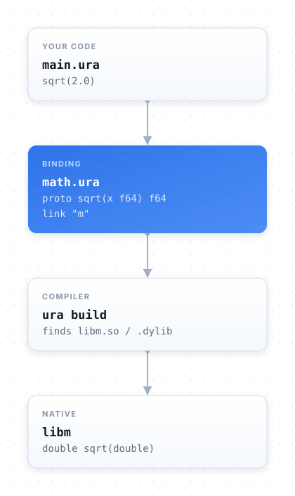
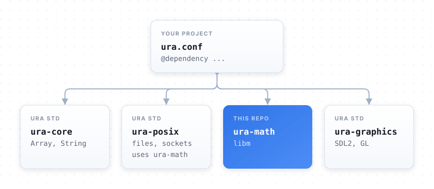

<p align="center">
  
</p>

<h1 align="center">ura-math</h1>

<p align="center">
  C's math library for <a href="https://github.com/mohammedhrima/ura-lang">ura</a>: trigonometry, powers, roots, logarithms, rounding.<br>
  Every function is a direct call into <code>libm</code>, with no wrapper in between.
</p>

<p align="center">
  
  
  
  
</p>

---

## At a glance

```ura
use "@/math"

PI f64 = 3.14159265358979

struct Vec2:
    x f64
    y f64

    operator +(o &Vec2) Vec2:
        return { x: self.x + o.x, y: self.y + o.y }

    fn length() f64:
        return sqrt(self.x * self.x + self.y * self.y)

    fn angle() f64:
        return atan2(self.y, self.x) * 180.0 / PI

fn main() i32:
    path Vec2
    for i in Range::create(0, 6):
        turn f64 = i as f64 * PI / 3.0
        step Vec2 = { x: cos(turn), y: sin(turn) }
        path = path + step
        output("step ", i, ": (", round(path.x * 100.0) / 100.0, ", ", round(path.y * 100.0) / 100.0, ")\n")
    output("distance from start: ", path.length(), "\n")
    hyp Vec2 = { x: 3.0, y: 4.0 }
    output("3-4-5: ", hyp.length(), " at ", hyp.angle(), " degrees\n")
    output("2^10 = ", pow(2.0, 10.0), ", cbrt(27) = ", cbrt(27.0), "\n")
    return 0
```

<table>
<tr><th>Output of <code>ura run</code></th><th>What it shows</th></tr>
<tr>
<td>

```
step 0: (1.000000, 0.000000)
step 1: (1.500000, 0.870000)
step 2: (1.000000, 1.730000)
step 3: (0.000000, 1.730000)
step 4: (-0.500000, 0.870000)
step 5: (-0.000000, 0.000000)
distance from start: 0.000000
3-4-5: 5.000000 at 53.130102 degrees
2^10 = 1024.000000, cbrt(27) = 3.000000
```

</td>
<td>

- six unit steps, each turned 60 degrees, walk a hexagon back to the start
- `cos`, `sin`, `atan2`, `sqrt`, `round`, `pow`, `cbrt` straight from libm
- a `Vec2` with `operator +` reads like the math
- `{ x: .., y: .. }` builds a struct value in place

</td>
</tr>
</table>

## Install

```
ura install ura-math 0.1.0 https://github.com/mohammedhrima/ura-math
```

It adds this line to your project's `ura.conf`. Then `use "@/math"` in any file:

```ura
@dependency "ura-math" "0.1.0" "https://github.com/mohammedhrima/ura-math"
```

## How a call reaches libm

<picture>
  <source media="(prefers-color-scheme: dark)" srcset="assets/call-dark.svg">
  
</picture>

- A `proto` declares a C function with ura types. `f64` is C's `double`, so the call needs no conversion.
- `link "m"` asks the compiler to link libm. It finds `libm.so` (or `libm.dylib` on macOS) in the usual folders, or in `$URA_LIBC`.
- All 43 functions take and return `f64`, except the classification ones, which return `i32`.

## API quick reference

| Group | Functions | Notes |
|---|---|---|
| trigonometry | `sin` `cos` `tan` `asin` `acos` `atan` `atan2` | radians; `atan2(y, x)` knows the quadrant |
| hyperbolic | `sinh` `cosh` `tanh` `asinh` `acosh` `atanh` | |
| exponential and log | `exp` `exp2` `expm1` `log` `log2` `log10` `log1p` | `expm1`, `log1p` stay precise near 0 |
| power and roots | `pow` `sqrt` `cbrt` `hypot` | `hypot(x, y)` is `sqrt(x*x + y*y)` without overflow |
| rounding | `ceil` `floor` `trunc` `round` `fmod` `remainder` | |
| sign, min, max | `fabs` `copysign` `fmax` `fmin` `fdim` | |
| classification | `isnan` `isinf` `isfinite` `signbit` | return `i32`, `0` for false |
| special | `tgamma` `lgamma` `erf` `erfc` | gamma and error functions |

<details>
<summary><b>Every function, with its signature</b></summary>

| Function | Signature |
|---|---|
| `sin`, `cos`, `tan` | `(x f64) f64` |
| `asin`, `acos`, `atan` | `(x f64) f64` |
| `atan2` | `(y f64, x f64) f64` |
| `sinh`, `cosh`, `tanh`, `asinh`, `acosh`, `atanh` | `(x f64) f64` |
| `exp`, `exp2`, `expm1` | `(x f64) f64` |
| `log`, `log2`, `log10`, `log1p` | `(x f64) f64` |
| `pow` | `(x f64, y f64) f64` |
| `sqrt`, `cbrt` | `(x f64) f64` |
| `hypot` | `(x f64, y f64) f64` |
| `ceil`, `floor`, `trunc`, `round` | `(x f64) f64` |
| `fmod`, `remainder` | `(x f64, y f64) f64` |
| `fabs` | `(x f64) f64` |
| `copysign`, `fmax`, `fmin`, `fdim` | `(x f64, y f64) f64` |
| `isnan`, `isinf`, `isfinite`, `signbit` | `(x f64) i32` |
| `tgamma`, `lgamma`, `erf`, `erfc` | `(x f64) f64` |

</details>

## The ura standard library

<picture>
  <source media="(prefers-color-scheme: dark)" srcset="assets/ecosystem-dark.svg">
  
</picture>

| Repo | Version | What | Depends on |
|---|---|---|---|
| [ura-core](https://github.com/mohammedhrima/ura-core) | 0.1.0 | Array, String, Range, Error, Os | nothing |
| [ura-posix](https://github.com/mohammedhrima/ura-posix) | 0.1.0 | the C library and the OS | ura-math |
| **ura-math** | 0.1.0 | C's math library | nothing |
| [ura-graphics](https://github.com/mohammedhrima/ura-graphics) | 0.1.0 | SDL2, raylib, OpenGL | nothing |

---

<p align="center">
  Part of <a href="https://github.com/mohammedhrima/ura-lang">ura-lang</a>
</p>
